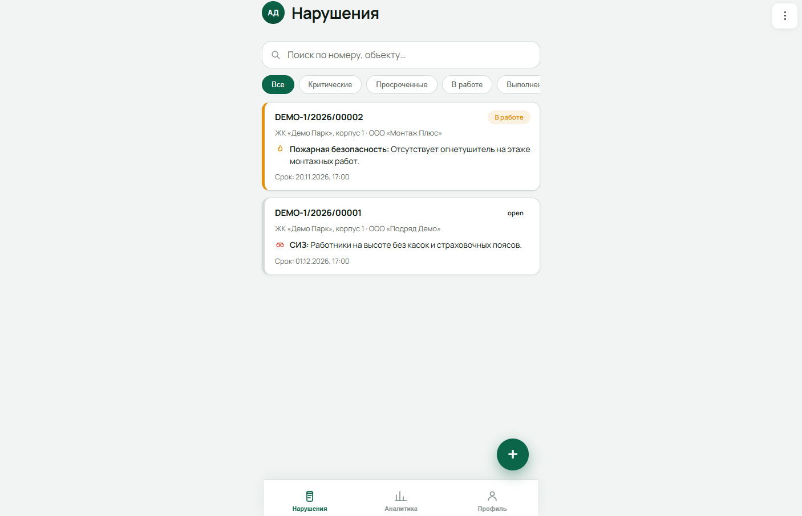

<p align="center">
  
</p>

<h1 align="center">Visural Audit</h1>

<p align="center">
  <strong>Фиксация нарушений охраны труда на стройплощадке</strong><br/>
  мобильное приложение + админ-панель + API
</p>

<p align="center">
  
  
  
  
</p>

---

Система для учёта нарушений ОТ на объектах строительства: фотофиксация с телефона, предписания, сроки устранения, уведомления и аналитика по подрядчикам и объектам.

В репозитории — демо с тестовыми данными. Боевые учётки, почта, пароли и скрипты выкладки не включены.

## Основные возможности

- **Мобильное приложение (PWA)** — фиксация нарушений на объекте, фото, категории, сроки
- **Админ-панель** — аналитика, журнал нарушений, объекты, организации, пользователи
- **Роли** — администратор, аудитор/проверяющий, подрядчик
- **Уведомления** — о новых нарушениях и сроках устранения
- **Документы** — предписания и выгрузки для работы с подрядчиками
- **API** — общий backend для мобильного клиента и админки

## Скриншоты

| Вход (админка) | Аналитика |
|:--------------:|:---------:|
|  |  |

| Журнал нарушений | Мобильное |
|:----------------:|:---------:|
|  |  |

## Стек

- **Node.js** HTTP API
- Хранение: JSON (`victory-check-api/data/db.json`; опционально PostgreSQL)
- Админка и мобильный клиент — статический web, раздаётся API

## Запуск

Нужен [Node.js](https://nodejs.org/).

```bat
start-demo.bat
```

| | |
|:--|:--|
| Админка | http://localhost:4000/admin/ |
| Мобильное | http://localhost:4000/mobile/ |
| Логин | `admin@demo.local` |
| Пароль | `123` |

Окно запуска не закрывайте — пока оно открыто, сервис работает.

## Структура

```text
victory-check-api/     — API и раздача /admin /mobile
victory-check-admin/   — веб-панель
victory-check-mobile/  — мобильный PWA-клиент
docs/screenshots/      — скриншоты
```

## Демо-данные

- Объекты: ЖК «Демо Парк», Офисный центр «Север»
- Подрядчики: ООО «Подряд Демо», ООО «Монтаж Плюс»
- Несколько нарушений с разными статусами (открыто / в работе / устранено)
- Пользователи: `admin@demo.local`, `inspector@demo.local` (пароль `123`)
