<p align="center">
  
</p>

<h1 align="center">Visural Audit</h1>

<p align="center">
  <strong>Фиксация нарушений охраны труда на стройплощадке</strong><br/>
  мобильное приложение + админ-панель + API
</p>

<p align="center">
  
  
  
  
</p>

---

Система для учёта нарушений ОТ на объектах: инспектор на площадке делает фото, оформляет акт в телефоне, подрядчик получает уведомление и отвечает отчётом об устранении. Админ видит всю картину в веб-панели — объекты, организации, люди, статусы, аналитика.

В репозитории — демо с тестовыми данными. Боевые учётки, почта, пароли и скрипты выкладки не включены.

## Как это работает на объекте

1. **Нашли нарушение** — инспектор открывает мобильное приложение и жмёт «+».
2. **Мастер из 8 шагов** — объект → организация → категория → **фото** → описание → нормы → критичность → подтверждение.
3. **Создаётся акт** — нарушение уходит в журнал, подрядчику уходит уведомление (push / email / Telegram — по настройкам).
4. **Подрядчик отвечает** — в карточке нарушения пишет отчёт об устранении и прикладывает фото «как стало».
5. **Закрытие** — статус меняют на «устранено» (инспектор или админ), история и комментарии остаются в карточке.

<p align="center">
  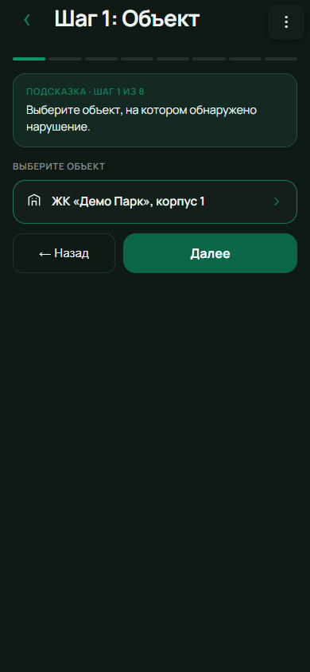
  &nbsp;
  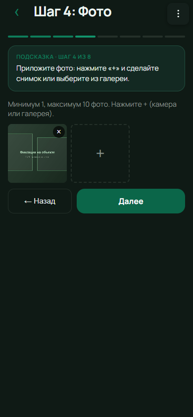
  &nbsp;
  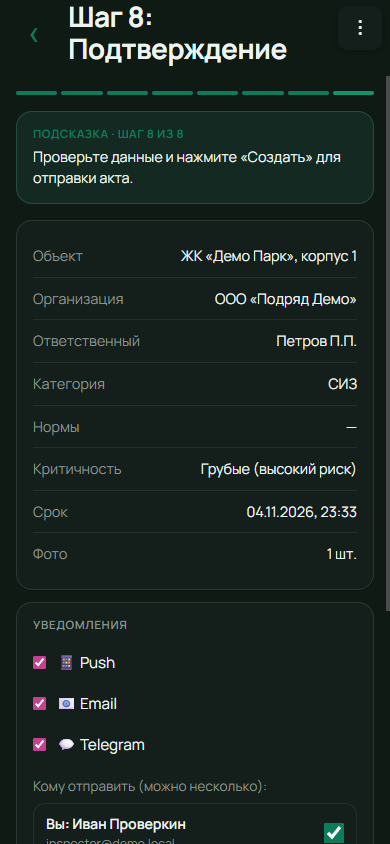
</p>
<p align="center">
  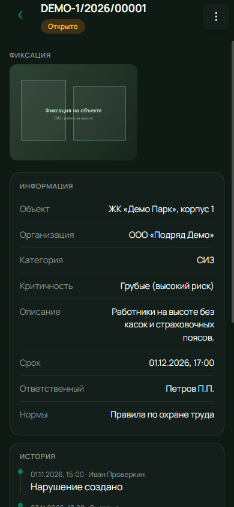
  &nbsp;
  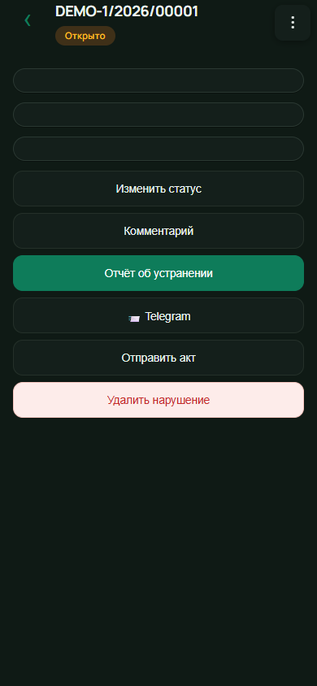
  &nbsp;
  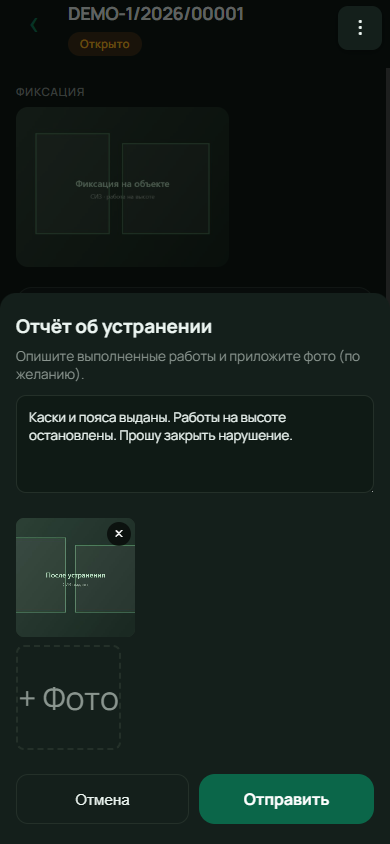
</p>

## Кто что может

### Администратор (`admin@demo.local`)

Веб-панель + полный доступ в мобильном:

- объекты, организации, категории, пользователи и роли;
- журнал всех нарушений, смена статусов, удаление;
- аналитика по категориям / подрядчикам / срокам;
- подтверждение новых регистраций;
- рассылка актов и уведомлений.

| Вход в админку | Аналитика |
|:--------------:|:---------:|
| 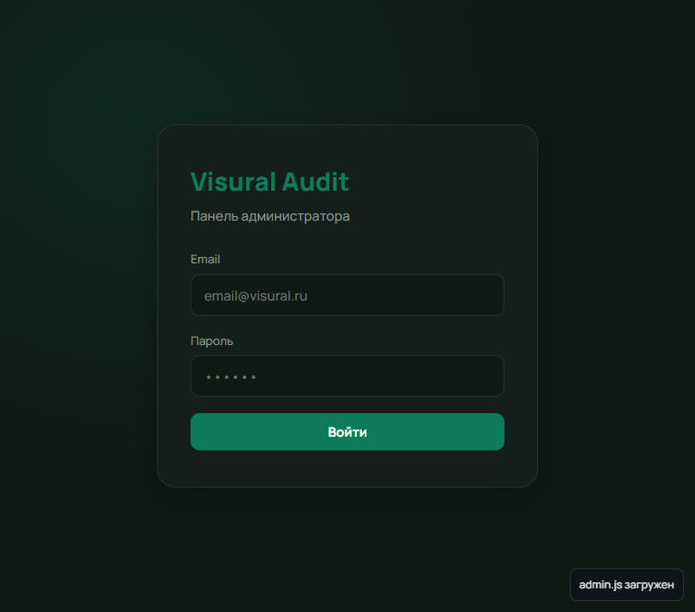 | 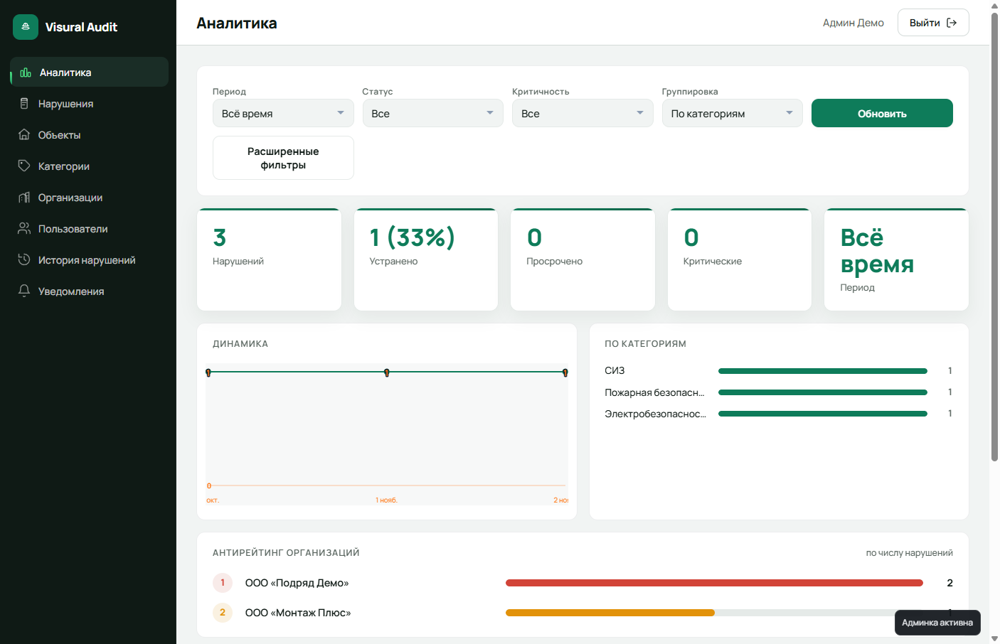 |

| Журнал нарушений | Пользователи и роли |
|:----------------:|:-------------------:|
| 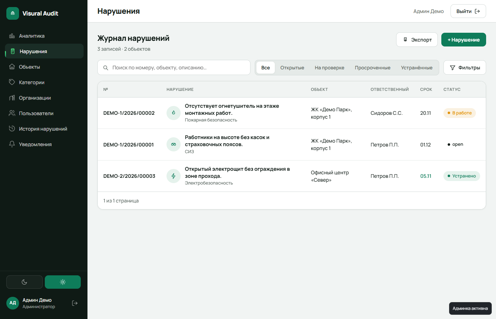 | 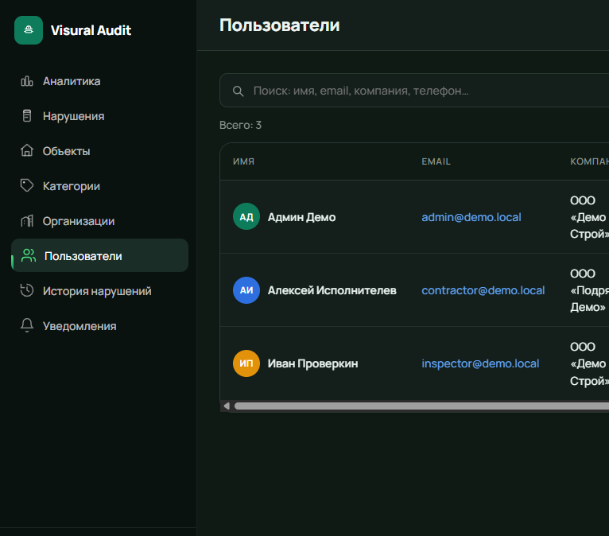 |

### Инспектор / аудитор (`inspector@demo.local`)

Обычный «человек на площадке» — работает в основном с телефона:

- лента нарушений по своим объектам;
- создание акта с фото (камера или галерея, до 10 снимков);
- комментарии, смена статуса, отправка акта подрядчику;
- просмотр аналитики по доступным объектам.

<p align="center">
  
  &nbsp;
  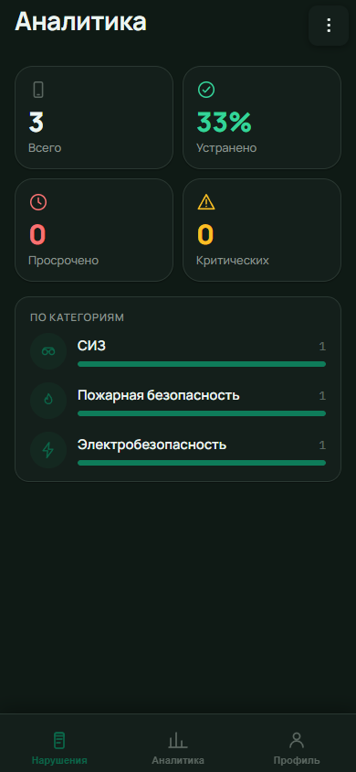
</p>

### Подрядчик (`contractor@demo.local`)

Исполнитель, которому прилетает предписание:

- видит нарушения своей организации;
- пишет комментарии и **отчёт об устранении** с фото;
- не управляет справочниками и чужими объектами.

Пароль для всех демо-учёток: `123`.

## Стек

- **Node.js** HTTP API
- Хранение: JSON (`victory-check-api/data/db.json`; опционально PostgreSQL)
- Админка и мобильный клиент — статический web, раздаётся API

## Запуск

Нужен [Node.js](https://nodejs.org/).

```bat
start-demo.bat
```

| | |
|:--|:--|
| Админка | http://localhost:4000/admin/ |
| Мобильное | http://localhost:4000/mobile/ |
| Логин | `admin@demo.local` |
| Пароль | `123` |

Окно запуска не закрывайте — пока оно открыто, сервис работает.

## Структура

```text
victory-check-api/     — API и раздача /admin /mobile
victory-check-admin/   — веб-панель
victory-check-mobile/  — мобильный PWA-клиент
docs/screenshots/      — скриншоты
```

## Демо-данные

- Объекты: ЖК «Демо Парк», Офисный центр «Север»
- Подрядчики: ООО «Подряд Демо», ООО «Монтаж Плюс»
- Несколько нарушений с разными статусами (открыто / в работе / устранено)
- Пользователи: `admin@demo.local`, `inspector@demo.local`, `contractor@demo.local` (пароль `123`)
